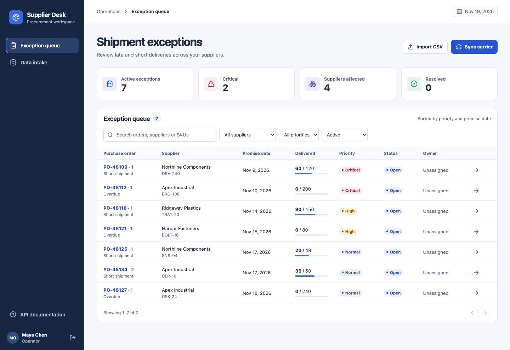

# Supplier Exception Desk

A procurement workspace for reconciling purchase orders with shipment evidence. Buyers can filter late and short shipments, inspect the underlying order and carrier records, and assign, acknowledge, or resolve an exception with a traceable history.

**Stack** React, TypeScript, FastAPI, PostgreSQL, SQLAlchemy, Alembic, and Docker Compose.



## Start the demo

Install Docker with Compose and run these commands from the repository root.

```sh
cp .env.example .env
docker compose up -d --build --wait
docker compose exec -T api python -m desk.seed
```

Open [the desk](http://127.0.0.1:8765) and sign in as `buyer@example.test`. The sample environment sets the password to `local-demo-only`. It also provisions `supervisor@example.test` as an operator and `viewer@example.test` as a read-only account, using the same local demo password.

The initial queue derives from 12 synthetic order lines and eight carrier shipment snapshots. Start with `PO-48109`, a critical short shipment. For intake, upload `fixtures/orders-mixed.csv` to see a valid insert, an unchanged replay, a source conflict, and field errors in one batch.

## Engineering decisions

- PostgreSQL constraints enforce source identity. A transaction-level lock coordinates overlapping intake runs. Each case modification uses a row lock and version check, with its audit entry written in the same transaction.
- The carrier integration uses HTTP and a separate local reference service. Starting and stopping that service exercises the actual network failure path. The desk records the last attempt and the last usable sync independently.
- FastAPI serves OpenAPI and the compiled React frontend. The browser uses generated TypeScript models and a server-side session, with role and CSRF checks applied by the API.

See [requirements](docs/requirements.md), [architecture and HTTP API](docs/architecture.md), and [deployment and operations](docs/deploy.md).

## Verify from a fresh stack

With Python 3.13, uv, Node 24, and Docker Compose available, install the locked dependencies and Chromium. The script starts a disposable Compose project, runs PostgreSQL integration tests and browser checks, and removes that project afterward.

```sh
uv sync --locked --python 3.13
npm --prefix frontend ci
npm --prefix frontend exec -- playwright install chromium
bash scripts/verify_local.sh
```

Set `DESK_CHROMIUM_EXECUTABLE` to use an installed Chromium-compatible browser. To run the read latency check on the seeded demo, run `.venv/bin/python -m scripts.benchmark --requests 120`. Runtime ports and demo settings are documented in `.env.example`.

The verified run passed 20 Python tests and three Playwright browser tests. See [verification results and benchmark conditions](docs/verification.md).
