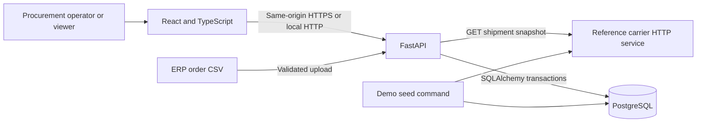

# Architecture



The browser uses an OpenAPI-generated TypeScript contract. FastAPI handles authentication, validates data at the HTTP boundary, and serves the compiled UI from the same origin. PostgreSQL stores order lines, shipment snapshots, workflow state, audit events, intake runs, and session token digests. The reference carrier serves synthetic snapshots over HTTP. In the default deployment it lives on the Compose network.

## Source contracts and recovery

| Source | Identity | Changed or invalid data |
| --- | --- | --- |
| Order CSV | `order_number` and `line_number` together | Exact repeats are unchanged. A different row with the same identity is flagged for review because this export has no revision field. Rows with invalid columns, quantity, or dates are rejected. |
| Carrier v1 | `shipment_id` and an immutable reference to an order line | A newer `updated_at` can update the shipment. A conflicting or older snapshot is rejected. Unknown order references are reported so the operator can load orders and retry. |

CSV input is UTF-8 and uses the exact header in [the fixture](../fixtures/orders.csv). Dates use `YYYY-MM-DD`. Each file allows up to 1 MiB and 2,000 nonblank records. The carrier returns a JSON object with `schema_version: 1` and a `shipments` list. Each shipment contains `shipment_id`, `order_number`, `line_number`, `quantity`, `status`, `carrier`, and a timezone-qualified ISO timestamp in `updated_at`. The API limits the response to 2 MiB and 2,000 entries. Each run stores aggregate counts and up to 25 validation issues. The rejected inputs themselves stay with the source.

The API fetches the carrier snapshot before taking the intake lock. An intake transaction then serializes with other imports using a PostgreSQL advisory lock, applies valid rows, reconciles evidence, and saves its run record. Rejecting individual rows can still leave a usable partial run. Unexpected failures roll back the entire transaction. An upstream transport or schema failure saves a failed run and leaves the accepted shipment snapshot intact. The latest attempt and last usable sync are tracked independently.

## Case lifecycle

- An order becomes an exception once the promise date has passed and delivered units are below the ordered quantity. Zero delivered units means overdue. A positive delivered quantity below the ordered quantity means short shipment. An in-transit or label-created shipment is visible as evidence.
- A case is critical at seven days past promise and high at three days. The business date determines lateness. The carrier evidence reflects the latest accepted snapshots.
- A new case starts open. An operator can assign it to an operator, acknowledge it, and resolve it with a reason. A supplier delivery can clear the underlying evidence while a case stays open for operator review. If a resolved case’s evidence clears and later indicates a new exception on the same line, reconciliation reopens it.
- Mutations take a row lock and check the submitted version. Reconciliation increments the version when evidence or priority changes. The case and audit event commit together. Intake transactions run reconciliation using the current configured business date.

## Authentication and diagnostics

The browser gets an opaque session cookie with HttpOnly and SameSite=Lax attributes. PostgreSQL stores a digest and expiry. Passwords use Argon2id. The API checks role and a per-session CSRF token on mutations. Authentication and CSRF checks still apply to direct API calls. Logout revokes the stored session. The runtime enables Secure cookies by default and the loopback example disables them for HTTP.

The API emits JSON events for ingestion outcomes, readiness failures, and requests with a correlation ID, status, and duration. The cookie, password, uploaded bytes, and SQL parameters are excluded from these events. An unexpected error returns HTTP 500 with the request ID while logs retain its exception class and source location.

## HTTP API

OpenAPI is available at `/api/openapi.json`, with a checked-in copy at [openapi.json](../openapi.json). Interactive API documentation is served at `/api/docs` and uses CDN-hosted Swagger assets. The static OpenAPI contract and browser workspace work on the local stack without those assets.

| Method and path | Purpose |
| --- | --- |
| `GET /api/health/live` and `GET /api/health/ready` | Process health and an accessible migrated database |
| `POST /api/session` | Sign in with email and password. Returns the user and CSRF token and sets the cookie |
| `GET /api/session` and `DELETE /api/session` | Inspect and end the session |
| `GET /api/overview` | Queue counts, suppliers, latest attempts, and last usable inputs |
| `GET /api/exceptions` | Paginated queue with search, supplier, status, priority, and signal filters |
| `GET /api/exceptions/{id}` | Order, shipment evidence, assignee, case version, and activity |
| `PATCH /api/exceptions/{id}` | Accepts `action` and `version` plus `assigned_to_id` for assignment or `reason` for resolution |
| `GET /api/operators` | Operator IDs and display names for assignment |
| `GET /api/imports/orders/template` | CSV header template |
| `POST /api/imports/orders` | Operator upload of a raw `text/csv` body |
| `POST /api/sync/carrier` | Operator refresh of the carrier snapshot |
| `GET /api/runs` | Recent intake results and validation issues |

Every protected write requires the session cookie and `X-CSRF-Token`. The intake endpoints return per-run counts and validation details. An invalid CSV envelope returns 422 with its stored run. A carrier transport or schema error returns 502 with its stored run. A whole batch with valid syntax and rejected rows returns a run with the appropriate status. Auth failures use 401 or 403, and stale case writes return 409. Responses include `X-Request-ID`.

After changing the API, regenerate the checked-in client types.

```sh
.venv/bin/python -m scripts.export_openapi
npm --prefix frontend run generate:api
```
